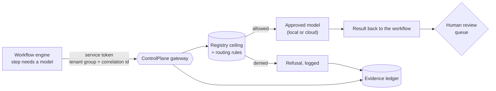

# ControlPlane: where it fits

ControlPlane puts four guarantees between people or systems and a language model:

1. **Retrieval is scoped by who is asking.** Postgres row-level security decides which documents can reach the
   model, before ranking. There is no post-filter to forget.
2. **Model access goes through one gateway.** A registry says which models exist and what data each may see.
   A rule file, ending in a deny, says which model may serve which request.
3. **Every outcome is evidence.** Answers and refusals both write to a hash-chained, append-only ledger.
4. **Releases pass a gate.** A golden-set eval ratchet and a prompt-injection red team run in CI.

This document lists places those guarantees are worth having, and is honest about how far each is from
working today.

**Status key**

| Mark | Meaning |
|---|---|
| **Today** | Works with what is in the repo now |
| **Small** | Needs a small addition: an endpoint, a config, a view |
| **Build** | Needs real design and code |

---

## At a glance

| # | Use | Who benefits | Status |
|---|---|---|---|
| 1 | Entitled Q&A over internal documents | Employees, support, ops | **Today** (the [control-plane-web](https://github.com/Lanier-Developments/control-plane-web) app is its front end) |
| 2 | Governed LLM steps inside backend workflows | Workflow and platform teams | **Small** to **Build** |
| 3 | Audit evidence for AI decisions | Compliance, security, auditors | **Today**, with one caveat (see 2) |
| 4 | One front door for model access and spend | Platform teams, finance | **Today** in code, **Small** in the UI |
| 5 | Release gate for prompts and models | Any team shipping RAG | **Today** |
| 6 | Prompt-injection testing for ingestion pipelines | Security | **Today** |
| 7 | Sensitive data stays on approved models | Regulated industries | **Today** |
| 8 | Governing agent tool calls | Agent builders | **Build** |
| 9 | Governance assessment for client engagements | Consulting | **Today** |
| 10 | Public demo with hard limits | Sales, open-source adoption | **Today** |

---

## 1. Entitled Q&A over internal documents

**Scenario.** HR, engineering and finance each have documents the others must not see. People ask questions
in plain language and get cited answers. A contractor must not get a production rollback command, and an
engineer must not get the salary bands.

**How ControlPlane fits.** Groups come from the identity provider token (or the persona table in
development). `doc_acl` plus RLS scopes the candidate set inside the database. A refusal says only that
nothing available answers the question. It never says "you lack permission", because that would confirm the
document exists.

**Front end.** The [control-plane-web](https://github.com/Lanier-Developments/control-plane-web) app (its
own repo): an Ask view, with routing decisions, retrieved sources and the ledger entry beside each answer.

**Status.** Today. Real use needs the identity-provider group claim mapped to document ACLs, and a real
ingest path in place of the synthetic corpus.

---

## 2. Governed LLM steps inside backend workflows

**Scenario.** Think of a multi-tenant workflow platform of the eFR type: many customers, each with its own
configured workflows, heavy on documents and exceptions. Steps like these are where a model helps, and where
nobody wants an unlogged call to a cloud API:

- Classify an inbound document and route it to the right queue.
- Draft a summary of a denial or exception for a human reviewer.
- Extract fields from a scanned form and flag low confidence for manual review.
- Propose which of a customer's configured workflows an exception belongs to.

**How ControlPlane fits.** The workflow engine does not talk to a model. It calls the gateway, and the
gateway applies the same registry ceiling, routing rules, budget and ledger entry as any other call.

**Mapping.**

| Platform concept | ControlPlane concept |
|---|---|
| A customer or hospital | A group, so RLS scopes any retrieval to that tenant |
| A workflow run | The correlation id, shared by the ledger entry and the model call log |
| A service account | A principal with its own budget ceiling |
| "This step may touch sensitive data" | The classification the call declares, which sets the allowed models |

**Gaps, in the order I would close them.**

1. **No endpoint for non-RAG calls (Small).** Only `/ask` is exposed, and it always retrieves. Backend steps
   need something like `POST /v1/complete` that wraps `gateway.complete()` with a caller-supplied system prompt,
   a classification and a correlation id. This is the smallest change that unlocks the whole use case.
2. **Classification is declared by the caller (Build).** In `/ask`, the most sensitive retrieved chunk sets
   the class, so the system works it out. A backend step has no chunks, so the caller says what its data is.
   The protection is then only as good as that claim. Derive the class from the source system's own tags, and
   have the gateway reject a call that omits it.
3. **The ledger stores question text in clear (Small).** For documents-only workloads that is fine. If a
   prompt can contain patient or customer data, the ledger becomes a permanent, undeletable copy of it, which
   is exactly what the answer digest was designed to avoid. Store a digest or a reference to the input, with
   the text kept in the source system.
4. **Machine identity (Small, to verify).** An identity provider that issues client-credentials tokens with a
   groups claim should work with the existing verifier, since it needs only `sub`, `iss`, `aud`, `exp`, `iat`
   and groups. I have not tested it against a real provider.

**Human review stays in the loop.** Nothing here removes the review queue. The ledger is what lets a reviewer
see which model produced a suggestion and under which rule.

---

## 3. Audit evidence for AI decisions

**Scenario.** Six months later someone asks: who asked, what were they entitled to, what was retrieved,
which model ran, why was it allowed, and has this record been touched?

**How ControlPlane fits.** One ledger entry per question answers each part. Refusals are entries too, which
is how you show the controls fired rather than only that they were configured. `verify` recomputes the whole
chain, and the Ledger tab in control-plane-web makes that a button.

**Be exact about the claim.** The chain is tamper-evident, not tamper-proof. Anyone who can rewrite the whole
table in order can forge a consistent chain, and so can deleting the newest rows or restoring an older
backup. `make anchor` closes that: it signs the head hash into a file kept where the database owner cannot
write, and `make verify-anchors` checks the ledger against it. The exposure window is the anchoring interval,
so schedule it.

**Status.** Today. Add: export a time range as a signed bundle for an auditor (Small), and see the caveat in
use 2 about question text.

---

## 4. One front door for model access and spend

**Scenario.** Teams hold their own provider keys, nobody knows what is approved, and a model is retired
without anyone finding out.

**How ControlPlane fits.**

- Adding, repricing or retiring a model is an edit to `policy/models.yaml`. No release.
- A retired model is refused, not absent, so the refusal is on the record.
- Providers behind the registry today: Ollama, Bedrock and Gemini.
- The code also meters per-model and per-principal budgets, steers unpinned requests by rule, and skips a
  provider whose recent error rate is too high. `make usage` reports all three.

**Status.** Today in code. The API exposes only totals and by-rule counts, so the UI cannot yet show budgets,
steering or provider health (Small: extend `/api/usage`).

**Worth saying to a buyer.** Which rules fire, and how often calls are refused, is the governance question.
The dollar figure is a side effect.

---

## 5. Release gate for prompts and models

**Scenario.** A prompt edit or a model swap "looks fine" and quietly starts leaking or inventing figures.

**How ControlPlane fits.**

- The answer prompt is a versioned, hashed artifact. Editing it without a version bump fails `make policy-test`.
- The golden set measures leaks at retrieval, not in the answer, because exposure happens when a chunk
  reaches the model.
- Two deterministic checks catch citation lies: a source tag naming a document never retrieved, and a
  currency or percentage figure that appears nowhere in the context.
- The gate is a ratchet. A new failure is a regression, and a fixed failure also turns the build red until the
  baseline is tightened, so the accepted-failure list can only shrink.

**Status.** Today. It applies to any RAG system, not only this corpus. Replace the corpus and golden set with
your own.

---

## 6. Prompt-injection testing for ingestion pipelines

**Scenario.** Anyone who can put text where the indexer reaches (a wiki page, a ticket comment, a vendor PDF)
can put text in front of the model.

**How ControlPlane fits.** `make redteam` runs eight attack classes in two document positions, with and
without context fencing. Poisoned documents are never ingested. The finding worth repeating is that injection
can change what the model says but cannot change what Postgres returns, because unauthorized rows were never
in the context.

**Status.** Today. For a client, run it against their prompt and their model, and report the measured attack
success rate and what the defense cost.

---

## 7. Sensitive data stays on approved models

**Scenario.** Regulated data such as patient records, legal holds or compensation must be processed only by
models the organisation controls.

**How ControlPlane fits.** The registry gives each model a ceiling. The most sensitive chunk governs the
whole call, because a prompt is indivisible once sent. A cloud model cannot be requested for confidential
content: the ceiling denies it before any rule runs, and the decision is logged. In the shipped corpus, every
call touching confidential or restricted documents routes to self-hosted inference.

**Status.** Today. Show it live: ask the same salary question as an entitled persona and as one without
entitlement, then once requesting a cloud model.

---

## 8. Governing agent tool calls

**Scenario.** An agent can call tools. The same questions apply: which tools may this agent use, with what
data, who decided, and where is the record?

**How ControlPlane fits (by extension, not today).** The pattern generalizes cleanly. A tool registry with a
ceiling per tool, a deny-by-default rule file, one choke point that every tool call passes through, and a
ledger entry per call. This is the "agent control plane" reading of the project.

**Status.** Build. It is design work, not a port: tool calls have side effects, so the rules need to express
arguments and not just data classes, and denial must happen before execution. It pairs naturally with the MCP
permission scanner: the scanner shows what a server can do, and the control plane decides what an agent may do.

---

## 9. Governance assessment for client engagements

**Scenario.** A client has a RAG system or an internal assistant and no evidence it respects permissions.

**How ControlPlane fits.** It is a reference implementation and a test kit in one. A fixed-scope engagement:

1. Build a persona matrix from the client's real groups.
2. Run the leak measurement against their retrieval: how often does a document the persona may not see reach
   the model's context?
3. Run the red team against their prompt and model.
4. Report the numbers, plus the smallest set of changes that moves them.

**Why it sells.** The repo's own results make the case: improving retrieval quality made one leak worse,
because retrieval got better at surfacing what it already had. A client who sees that on their own system
understands why permissions must be enforced before retrieval.

**Status.** Today for the method. A packaged assessment (templates, a report format) is Small.

---

## 10. Public demo with hard limits

**Scenario.** You want people to try it without it costing money or becoming an open proxy.

**How ControlPlane fits.** Demo mode restricts requests to self-hosted models, can accept only the example
questions, and rate-limits per client. The control-plane-web app reads `/api/demo` and renders those limits honestly:
a locked question box, disabled cloud models and a banner.

**Status.** Today. Put real rate limiting at the edge for anything beyond a single instance.

---

## Suggested order of work

| Step | Change | Unlocks |
|---|---|---|
| 1 | `POST /v1/complete` over `gateway.complete()`, with required classification and correlation id | Use 2 |
| 2 | Ledger option to store an input digest in place of question text | Use 2 with sensitive prompts |
| 3 | Extend `/api/usage` with budgets, steering and provider health, and show them in control-plane-web | Use 4 |
| 4 | Signed ledger checkpoints and a range export | Use 3 for external auditors |
| 5 | Packaged assessment kit | Use 9 |
| 6 | Tool-call governance design | Use 8 |

Steps 1 to 3 are small and independent. Step 1 alone turns ControlPlane from "a governed Q&A service" into
"a governed gateway that backend systems can call", which is the larger idea.
